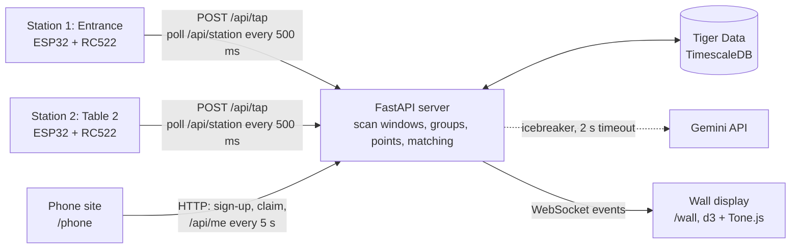
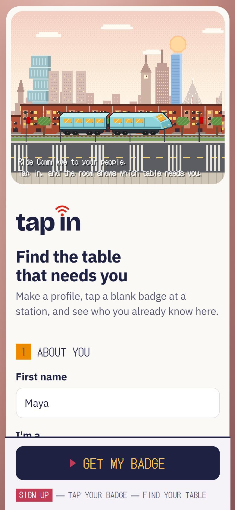
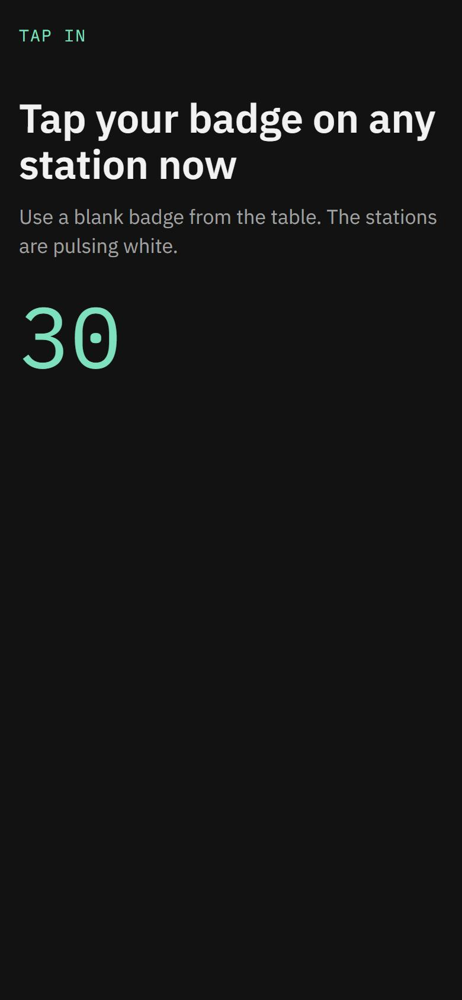
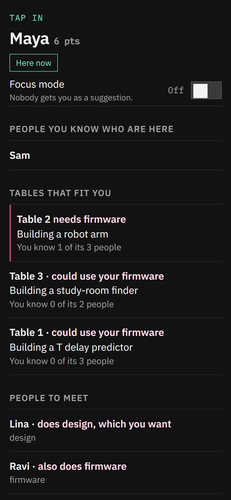
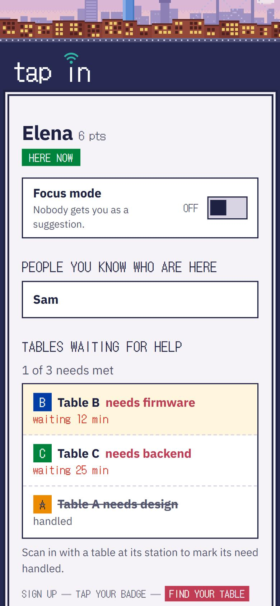

# Tap In

**You walk into a room, tap in, and it shows you which table needs you.**

<!-- Demo GIF goes here once the 5 PM checkpoint works: docs/tap-to-wall.gif (a badge tap lighting up the wall). -->

Built at BostonHacks 2026 for the **Boundless Boston** track and the **Spark! Hack Our Space** subtrack. Our domain is tapin.boston.

## The problem

Boston is America's college city, but walking into a room full of students doesn't tell you who to sit with. New students end up studying alone next to groups they could have joined.

Tap In turns walking into a room into a way to find your people. Tap your badge at a station when you arrive, and the wall display and your phone show where you stand: who you already know here, and which tables could use your skills. Walk over, scan in together with the group, and you're part of it. Everyone earns points for meeting new people.

## How it works

There is one action: **tap**. The server groups taps that land on the same station within 6 seconds into one scan.

| Scan | What happens |
|---|---|
| 1 badge | **Check-in.** You light up on the wall as "here now", with lines to people you already know and the open groups that fit you. |
| 2+ badges, none in a group | **New group.** Everyone is linked to each other and lands on the map as one cluster. |
| 2+ badges, one already in a group | **Join.** The others join that group and get linked to every member. |
| A mentor or staff badge in the scan | **Help.** The group's need is marked handled and the mentor shows as a bridge between groups. |
| Everyone already met | **Repeat.** No points; the connection gets stronger. |

A join only counts when the whole group scans in at the same station, so the hardware itself proves people actually met.

- **Phone site:** sign up in about 30 seconds (first name, up to 3 skills, up to 2 "looking for" tags), then tap any blank badge to claim it. Your "where you stand" page shows people you know who are here, your top groups with a reason ("Table 2 needs firmware"), and your points.
- **Wall display:** a live room view where each group is a cluster labeled with its table and what it's building, plus stats, a leaderboard, a needs board, and an activity log. It plays a pentatonic bell when someone arrives and a pluck for every new link.
- **Modes:** groups can be open or heads-down, and people can check in on focus mode. Heads-down groups and focus people are never suggested.
- **Points:** +1 for your first check-in of the day, +5 for each new person you connect with, +10 for joining a group, and +5 to each current member when someone joins. The group's points double when the newcomer had fewer than 2 connections.

## Architecture



- **Stations** are dumb: they send a badge UID with `POST /api/tap`, poll `GET /api/station/{id}` every 500 ms, and show whatever state the server returns on the board's built-in blue LED, one blink rhythm per state. No LED strip, no buzzer.
- **Server:** Python FastAPI on one event loop. Each station has at most one open scan window, and every tap restarts its 6 s timer. The window is popped before it's resolved, so a tap that lands mid-resolve opens a fresh window instead of corrupting the old one.
- **Database:** Tiger Data (see below).
- **Wall and phone** are plain HTML/JS served by the same server at `/wall` and `/phone`, so there's only one thing to run.

```
server/     FastAPI app: tap API, scan windows, groups, points, matching, claims, DB, Gemini
firmware/   station.ino (one sketch, STATION_ID set at the top)
wall/       Wall display: room view, panels, sound
phone/      Sign-up, claim, and "where you stand" pages
tools/      fake_taps.py, seed.py, count.py, check_db.py, and the agent board script (tools/board)
tests/      Scan scenarios, API, matching and Gemini checks
docs/       Images for this README, the printable station sign
```

## Screenshots

| Sign-up | Tap your badge | Where you stand | Mentor view |
|---|---|---|---|
|  |  |  |  |

Phone screenshots were taken in FAKE mode (hard-coded sample data, no server), using the fake people from `tools/seed.py`.

<!-- docs/wall-checkin.png: the wall mid check-in, with lines and a suggested group -->
<!-- docs/group-forming.png: a group forming on the wall -->
<!-- docs/phone-signup.png: the phone sign-up page -->
<!-- docs/needs-board.png: the needs board with a handled need crossed out -->
<!-- docs/stations-boxed.jpg: both stations in their enclosures -->

## Station wiring

Each station is an ESP32 dev board and an RC522 reader on a breadboard. No soldering, except the RC522 header pins if they came loose.

<!-- Station photo goes here: docs/station.jpg -->

| From | To | Wire |
|---|---|---|
| RC522 SDA (NSS) | ESP32 GPIO 5 | F-F |
| RC522 SCK | ESP32 GPIO 18 | F-F |
| RC522 MOSI | ESP32 GPIO 23 | F-F |
| RC522 MISO | ESP32 GPIO 19 | F-F |
| RC522 RST | ESP32 GPIO 22 | F-F |
| RC522 3.3V | ESP32 3V3 (never 5 V) | F-F |
| RC522 GND | ESP32 GND | F-F |

The RC522 IRQ pin stays unconnected. The station's feedback is the ESP32's built-in blue LED: a heartbeat blip when idle, solid while collecting badges, 3 blinks a second for a check-in, a fast flicker for a join, a double blink for an unknown badge, a slow blink while a sign-up waits for a badge, and a brief blink every 2 s when offline. The firmware can still drive an optional NeoPixel strip on GPIO 16 if one is wired later.

In the enclosure the reader is taped flat under a non-metal lid (3 mm or thinner) with the antenna up, under a paper label printed with "Tap in".

**Firmware libraries:** MFRC522, Adafruit_NeoPixel, ArduinoJson, plus the built-in WiFi and HTTPClient. The firmware never calls `delay()`, uses an 800 ms HTTP timeout, and shows "collecting" the moment a card is read, before the server answers.

## Setup

**Server** (one laptop runs everything):

```bash
pip install -r server/requirements.txt
cp .env.example .env              # fill in DATABASE_URL and GEMINI_API_KEY
python tools/check_db.py          # checks the database connection and TimescaleDB
uvicorn server.main:app --host 0.0.0.0 --port 8000
```

- Wall: `http://<server-ip>:8000/wall`. Click **Start** once to enable sound.
- Phone: `http://<server-ip>:8000/phone`
- No internet? Run the same schema on a local TimescaleDB with `docker run -d -p 5432:5432 -e POSTGRES_PASSWORD=tapin timescale/timescaledb:latest-pg16`, then point `DATABASE_URL` at it.

**Without hardware:**

```bash
python tools/fake_taps.py --events                              # fake room for the wall, no server or DB needed
python tools/fake_taps.py --taps --server http://localhost:8000 # runs the tap test scenarios against a real server
python tools/fake_taps.py --cleanup                             # deletes the Test people the scenarios leave behind
python tools/seed.py                                            # adds a fake room: 20 people with 5EED badges, 4 groups
python tools/seed.py --judge1 <UID> --judge2 <UID>              # registers two spare cards as Judge 1 and Judge 2
python tools/count.py                                           # real people, groups, help scans and links (no fakes)
```

Fake badges always start with `5EED`, so `count.py` reports only real people. Never run `tools/seed.py --reset` after recruiting starts: it deletes every real sign-up.

**Stations:** open `firmware/station.ino` in the Arduino IDE with ESP32 support installed, set `STATION_ID` (1 or 2) at the top, and upload. Stations join the private 2.4 GHz `TapIn` network and talk to the server at `192.168.8.100:8000`.

## Built on Tiger Data

Taps are time-series data, so Tap In runs on [Tiger Data](https://www.tigerdata.com) (TimescaleDB). Profiles and time-series live side by side in one Postgres database, queried with plain SQL. The schema is in [`server/schema.sql`](server/schema.sql).

| Table | Kind | What it holds |
|---|---|---|
| `taps` | hypertable on `ts` | Every raw tap: station, badge UID and result |
| `scan_events` | hypertable on `ts` | Every resolved scan: check-in, join, new group, repeat or help, with its size and group |
| `scans_per_10min` | continuous aggregate (being added with the stats panel) | Scans per 10 minutes by station and kind, for the live stats chart |
| `people`, `groups`, `group_members`, `connections`, `needs` | regular tables | Profiles, groups, the connection graph and open needs |

```sql
SELECT create_hypertable('taps', 'ts', if_not_exists => TRUE);
SELECT create_hypertable('scan_events', 'ts', if_not_exists => TRUE);
```

The stats panel reads `scans_per_10min` instead of scanning raw rows. The view is created with `materialized_only = false`, so the last few minutes show up before they're materialized and the chart stays live.

`connections` is deliberately a regular table: a unique index on a hypertable has to include the time column, and Tap In needs exactly one row per pair of people.

## Gemini icebreakers

When someone checks in, the wall shows their top suggested group right away with a template line. In the background, the server asks the [Gemini API](https://ai.google.dev) (`gemini-2.5-flash`) for one icebreaker under 20 words, written from the person's name and skills and the group's project and needs.

- **Never blocks a tap.** The call runs in a background task with a 2 second timeout.
- **Always has a fallback.** On a timeout, an error or a missing key, the wall keeps the template line.
- **Cached** by person and group, so the same pair never costs a second call.
- **The key stays on the server.** `GEMINI_API_KEY` lives in `.env` on the server laptop and is sent only to Google. It's never in the repo or the browser.

The code is in [`server/gemini.py`](server/gemini.py).

## How we built it: the agent board

Every teammate's coding agent posts to one pinned GitHub issue, the [agent board (#1)](https://github.com/BU-Hackathonz/TapIn/issues/1). Agents tag each other by GitHub username and wait for their own tag, so one person's agent can hand work to another's without anyone sending a text. `AGENTS.md` has the rules and says who owns which folder.

Each teammate runs this once, in Git Bash on Windows or Terminal on a Mac:

```bash
gh auth login
tools/board whoami      # prints your login
tools/board unread      # catch up on the board
```

| Command | What it does |
|---|---|
| `tools/board post "[Avery's Claude] ..."` | Posts to the board. Every post starts with whose agent it is. |
| `tools/board unread` | Shows new posts and flags the ones that tag you. |
| `tools/board wait` | Blocks until someone else posts. |
| `tools/board read -n 20` | Shows the last 20 posts. |

## Team

| Person | GitHub | Owns |
|---|---|---|
| David (lead) | [@dribeiro0](https://github.com/dribeiro0) | Server, Tiger Data, Gemini, network |
| Avery | [@DxubleBTW](https://github.com/DxubleBTW) | Station hardware and firmware, enclosures, stats and leaderboard |
| Jun | [@sysoutprntlne](https://github.com/sysoutprntlne) | Wall display and sound |
| Yaovi | [@unseentrader007](https://github.com/unseentrader007) | Phone site, seed data, recruiting, pitch and Devpost |

## Credits

- **Server:** [FastAPI](https://fastapi.tiangolo.com), [Uvicorn](https://www.uvicorn.org), [asyncpg](https://github.com/MagicStack/asyncpg), [HTTPX](https://www.python-httpx.org)
- **Database:** [Tiger Data](https://www.tigerdata.com) / [TimescaleDB](https://github.com/timescale/timescaledb)
- **AI:** [Google Gemini API](https://ai.google.dev)
- **Wall display:** [d3](https://d3js.org), [Tone.js](https://tonejs.github.io), [IBM Plex](https://github.com/IBM/plex)
- **Firmware:** [MFRC522](https://github.com/miguelbalboa/rfid), [Adafruit NeoPixel](https://github.com/adafruit/Adafruit_NeoPixel), [ArduinoJson](https://arduinojson.org), [Arduino core for ESP32](https://github.com/espressif/arduino-esp32)
- **Domain:** tapin.boston, registered through [GoDaddy Registry](https://www.godaddy.com/registry)
- **Agent board:** the hackathon agent board template

## License

[MIT](LICENSE)
