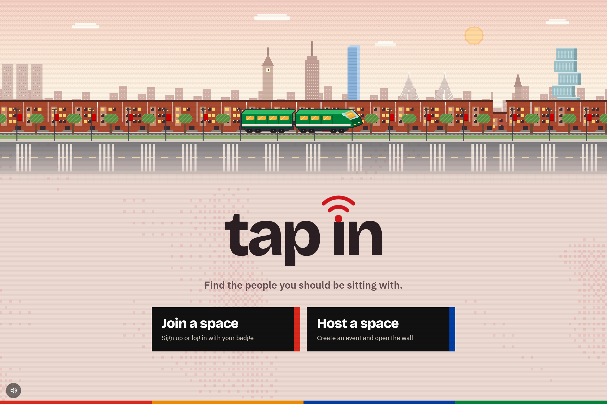
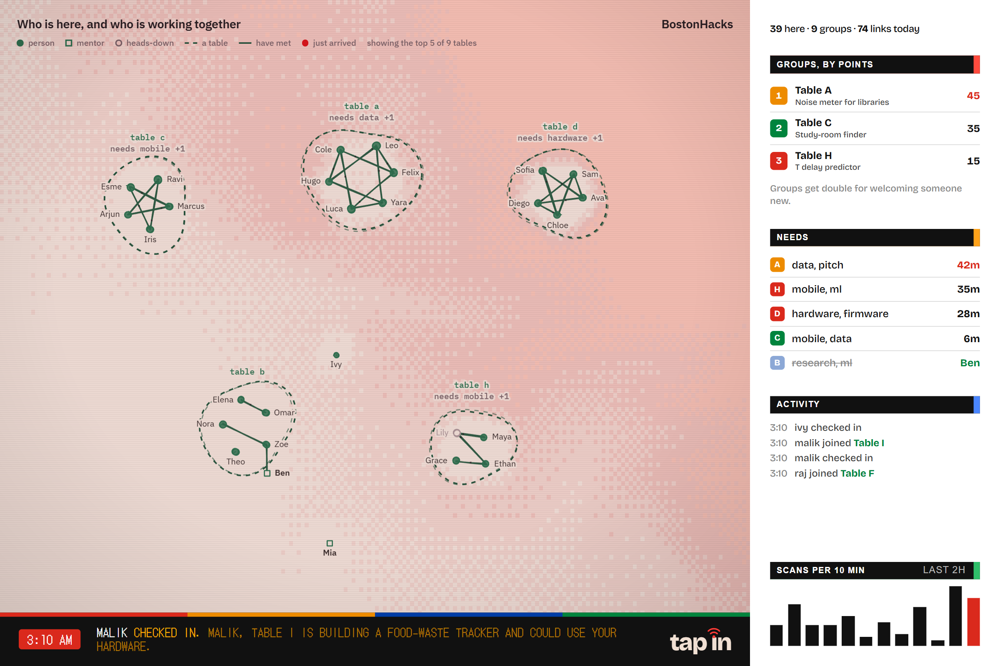
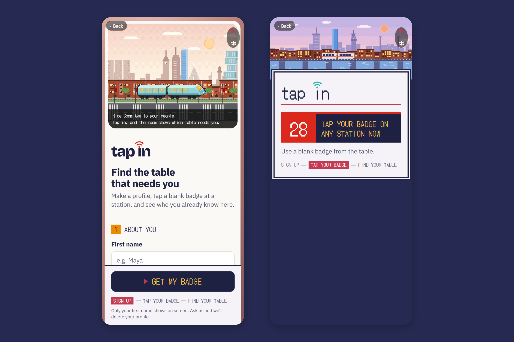
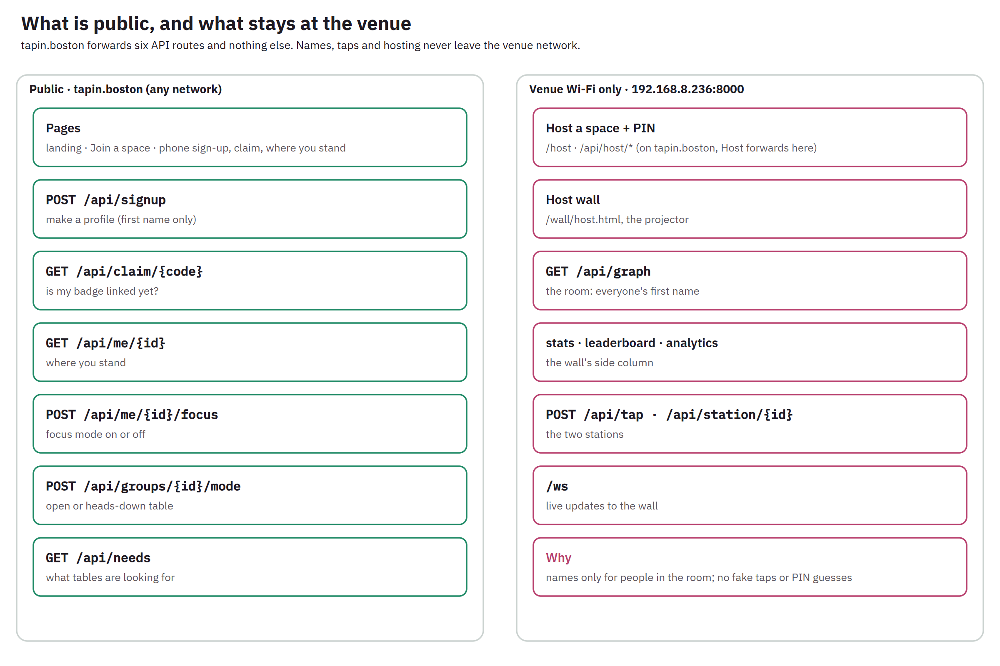
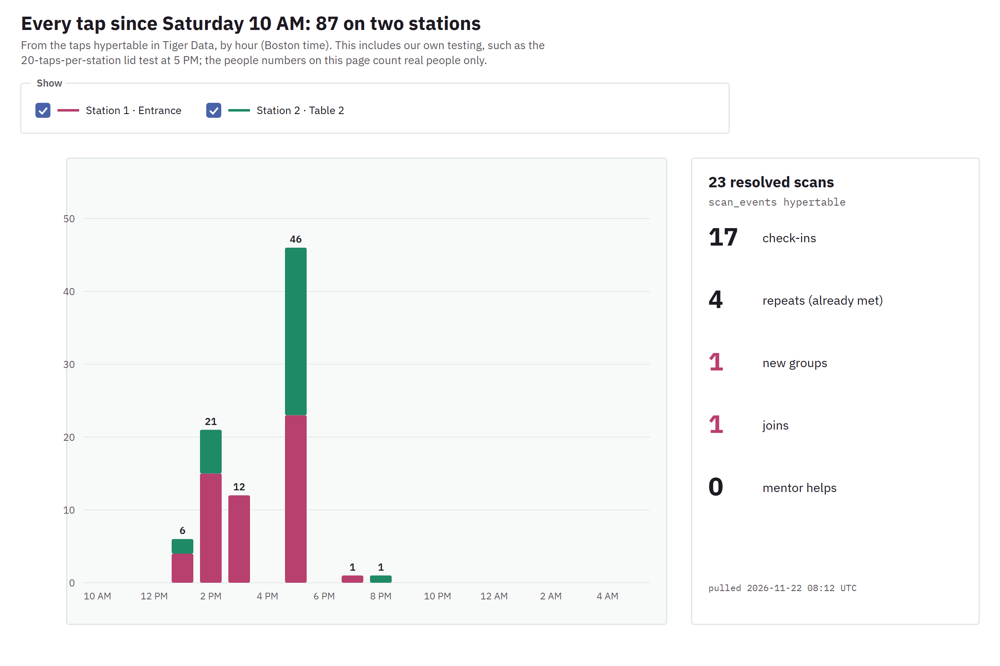
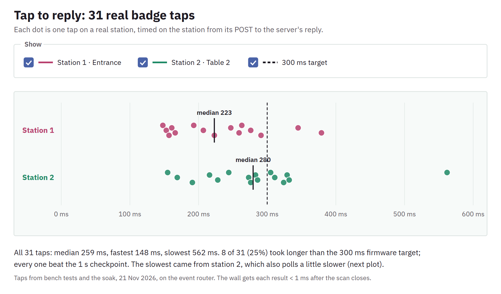
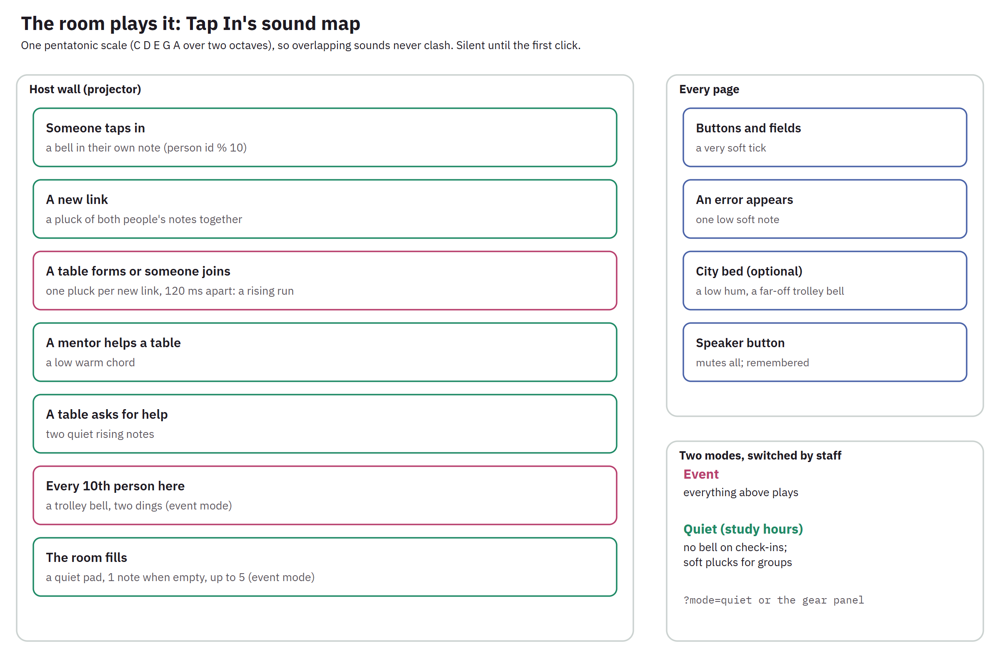
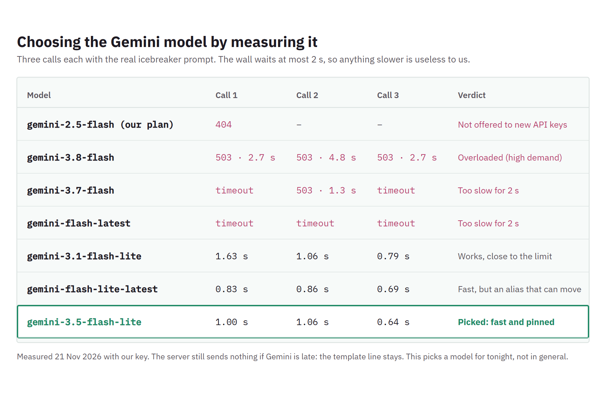

# Tap In: Devpost story (paste into "About the project")

<!-- Owner: Avery. Paste everything below the line into Devpost's "About the project". Numbers marked (refresh 8:15)
come from tools/count.py (real people only) and media/devpost/src/pull_live.py; re-run both at 8:15 AM and update. -->

---

## Inspiration

Boston is America's college city, and it is easy to be alone in it. You walk into a library, a lab or a hackathon room full of students, and nothing tells you which table to walk up to. So you sit alone next to a group you could have joined. Every shared space we know has the same gap: a room full of people who would help each other, and no way for a newcomer to see where they fit.

Spark! asks for hacks that get people in a space interacting, and its own example list includes RFID card taps that trigger sounds. We built exactly that, with one rule on top: joining a table only counts when everyone taps the same station together, so the room itself proves people met.

## What it does

**One action: tap your badge.** The server groups taps on the same station within 6 seconds into one scan. One badge is a check-in; two or more is a group.

- **Join a space.** At tapin.boston (any network) or on the venue Wi-Fi, you make a profile in about 30 seconds: a first name, your role, up to 3 skills, up to 2 things you're looking for, and what you're working on today. That last field has quick picks that aren't projects ("Just hanging out", "Meeting new people", "Looking for a team", "Studying", "Exploring ideas"), so nobody has to be building something to tap in. Then you tap any blank badge on a station within 30 seconds, and it becomes yours. That tap also checks you in.
- **Where you stand.** Your phone shows who you already know here, the tables that fit you with the reason ("Table B needs firmware, you know 1 of its 3 people"), people to meet, and your points. You can switch on focus mode, or switch your table to heads-down, and you stop being suggested.
- **Join a table.** Walk over and tap the station together with the table. You're linked to everyone there, and you and the table both earn points. A mentor who taps in with a table counts as help, and the table's need is crossed off.
- **The room plays it.** The projector shows a room plan with every table by letter, a side column with groups by points, open needs and how long they've waited, recent activity and scans per 10 minutes, and a strip with the latest moment. Every event has a sound from one pentatonic scale: a bell in your own note when you tap in, a pluck for each new link, a rising run when a table forms, and a trolley bell for every 10th person.
- **Host a space.** A host signs in with a PIN on the venue Wi-Fi, creates the event (name and number of tables, saved on the server) and opens the room display. Quiet mode turns the room down for study hours.

The host wall, filled from our fake server (made-up people, no database) so this picture shows no real attendee.

The real phone sign-up and the 30-second badge claim.

## How we built it

**Stations.** Each station is an ESP32 and an RC522 reader in a box, with the reader under the lid. It sends the badge's UID to the server and shows the state the server returns, polling every 500 ms with 800 ms timeouts, and rejoins Wi-Fi by itself. All logic lives on the server.

**Server.** Python FastAPI on one laptop on the venue Wi-Fi. A scan window per station lasts 6 seconds and restarts on every tap; the same badge within 3 seconds counts once. When the window closes, one database transaction decides what the scan means (check-in, new group, join, help or repeat), awards points, updates suggestions and pushes the result over a WebSocket. The server runs under a small supervisor that restarts it if it exits, outside the terminal session, so a closed window doesn't take the room down.

**Wall and phone.** The host wall is plain JavaScript on a canvas with Tone.js for sound. The phone pages are plain HTML and JavaScript with no app and no login: your badge is your identity.

**tapin.boston.** The pages are static files on Vercel (Jun's project). Six API routes (sign-up, claim status, where you stand, focus, table mode and needs) are forwarded through a Cloudflare tunnel to the laptop. Everything else stays on the venue network: the room with everyone's first name, the stations' taps, hosting and live updates. "Host a space" on tapin.boston forwards to the venue address, which only loads on the venue Wi-Fi, so the host PIN never faces the internet.

**How four people built it.** We wrote every JSON shape down before writing code, so the stations, server, wall and phone were built in parallel. Each of us worked with a coding agent, and all the agents read and posted on one pinned GitHub issue: they asked the owner before touching a teammate's files and flagged contract changes to everyone. We merged 93 pull requests.

## Real numbers

From the live database (refresh 8:15). The people numbers count real people only; our test and judge badges are excluded.

- **3** people signed up and claimed a badge (3 more signed up but never tapped a badge)
- **1** table formed, **1** new connection, **0** mentor help scans
- **87** taps and **23** resolved scans since Saturday 10 AM (17 check-ins, 4 repeats, 1 new group, 1 join), including our own testing

Measured on our two stations on Saturday:

- **259 ms** median from tap to reply over 31 real taps; a quarter missed our own 300 ms target, all beat 1 second.
- **40-minute soak** with no failed polls, reboots or time offline.
- **Server down for 19 s:** both stations showed offline and came back on their own within about 1 second.
- **Router unplugged:** both stations rejoined about 5 seconds after its Wi-Fi came back, with the same addresses and no reboot.
- **Reading through the lid:** 20 of 20 taps on one station, 19 of 20 on the other.

## Boundless Boston (main track)

Boston has more students per square mile than almost anywhere, and most of them study in shared rooms: libraries, dorm lounges, labs and cafés. Any of them could run Tap In with two stations at about $15 of parts each, cents per badge, a laptop and a screen. Nothing about it is specific to a hackathon. The landing page's Green Line train down Comm Ave is our reminder of where it belongs.

## Spark! Hack Our Space

- **Interaction between people is built into the hardware.** A join only counts when everyone taps the same station within seconds of each other. The scan is the proof that people met.
- **RFID taps trigger sounds,** straight from Spark's own example list: every tap, link, table and mentor help has its own sound from one pentatonic scale, and every 10th arrival rings a trolley bell. Staff switch the room between event mode and quiet mode for study hours.
- **For the space's staff:** the needs board shows what each open table is looking for and how long it has waited, mentor taps count as help, and hosts set the room up with a PIN.
- **A permanent install:** stations at the entrance, the couches and the workbenches, points tied to a real perk in the lab, and the busiest-station-by-hour view showing how the space connects people.

## MLH: Best Use of Tiger Data

Tap In is a stream of taps, so its data is time-series from the first byte, and Tiger Data holds all of it.

- **Hypertables:** every raw tap goes into `taps` (station, badge, result) and every resolved scan into `scan_events` (kind, size, station, group), both partitioned on time.
- **Continuous aggregates:** `scans_per_10min` counts scans per station and kind in 10-minute buckets in real-time mode, so the wall's chart includes the newest minutes before the 1-minute refresh. `scans_per_hour` is a hierarchical continuous aggregate built on top of it, refreshed every 5 minutes, for the busiest-station-by-hour view.
- **What reads them:** `/api/stats` (people here, groups, links today, busiest station, 12 ten-minute buckets) is pushed to the wall every 30 seconds; `/api/analytics` returns the last 24 hours by station and the mix of scan kinds.
- **Design choices:** `connections` is a regular table on purpose, because a unique index on a hypertable must include the time column and we need one row per pair of people. The schema is idempotent and runs on every server start, so a restart mid-event never breaks the database.

## MLH: Best Use of Gemini API

When someone checks in, the wall shows their top table right away with a template line. In the background the server asks Gemini (`gemini-3.5-flash-lite`) for one icebreaker under 20 words from the person's skills and the table's project. If it answers within 2 seconds, the wall swaps the line in; if it's late or fails, the template line stays, so Gemini can only make the wall better, never slower. Answers are cached per person and table, and the API key stays on the server.

We picked the model by measuring it: the model in our plan returned 404 for new keys, and of the ones we timed with our real prompt, 3.5-flash-lite answered in 0.6 to 1.1 s while two newer models were overloaded or timed out.

## Challenges we ran into

- **Scan windows.** Taps arrive milliseconds apart, sometimes at two stations at once. Each station keeps one window whose timer restarts on every tap, and the window is removed before it resolves, so a tap that lands mid-resolve starts a fresh scan instead of corrupting the old one.
- **Ten badges.** We had 10 NFC badges and each one belongs to one person for good, so only a handful of real people could join. We kept the judge badges for the demo and counted honestly instead of seeding the database.
- **The public site.** A static page on the internet can't reach a laptop on a private router. A tunnel solved that, but its default protocol kept dropping on the venue network until we switched it to HTTP/2 over TCP, and we had to decide exactly which routes are public.
- **Small bugs with big effects.** The host PIN never matched when the `.env` line had quotes; the wall's mute switch never muted because `Sound` isn't `window.Sound`; the session that ran our server restarted twice overnight and took the room down, so the server and tunnel now run as their own processes.

## Accomplishments that we're proud of

- Both stations passed 30- and 40-minute soak tests, a server outage and a router unplug, and recovered on their own each time.
- A real phone on any network can sign up at tapin.boston, while names, taps and hosting never leave the venue network.
- Four people merged 93 pull requests in about 24 hours without breaking main, coordinating through one shared board.

## What didn't work

- **Few real users.** With 10 badges and one badge per person, 3 real people claimed a badge (refresh 8:15). The numbers above are what they are.
- **The station LEDs.** We planned five LEDs per station and cut them for time, so a station shows its state with the board's small built-in light, and the room's feedback comes from the wall and its sound.
- **About 200 ms per station request** on a network with 3 ms ping. We ruled out the Wi-Fi signal, connection reuse and the server, and ran out of time to chase it into the ESP32's network stack.
- **Prototype parts.** The join page's "Log in" (Google, GitHub or badge) and the account panel keep everything in the browser; they are not connected to the server. "Sign up" on that page goes to the real sign-up. We also built a room-map intro animation and removed it from the host wall.

## What we learned

- **Agree on the contracts first.** Writing every JSON shape down before coding let four layers meet on the first try.
- **Measure, don't assume.** The planned Gemini model didn't exist for our key, the router had a different name than our plan, and the tunnel's default protocol didn't survive the venue network. Each time, a measurement told us what to do.
- **Decide what is public on purpose.** Listing the six routes the public site needs, and nothing else, kept names, taps and the host PIN off the internet.

## What's next for Tap In

- A permanent install at Spark!, with points tied to real perks in the lab.
- Releasing a badge back to the table when someone leaves, so 10 badges can serve a whole room.
- Signed NTAG424 badges instead of UIDs that can be cloned.
- Connecting the join page's log-in and account panel to the server.
- More rooms in Boston: libraries and dorm lounges, where the same stations would work unchanged.

## Explore Tap In

- [tapin.boston](https://tapin.boston): the landing page and the real phone sign-up
- [Source code on GitHub](https://github.com/BU-Hackathonz/TapIn): server, station firmware, wall, phone site and every test
- [How each image was made, and the data behind the charts](https://github.com/BU-Hackathonz/TapIn/tree/main/media/devpost/src)
