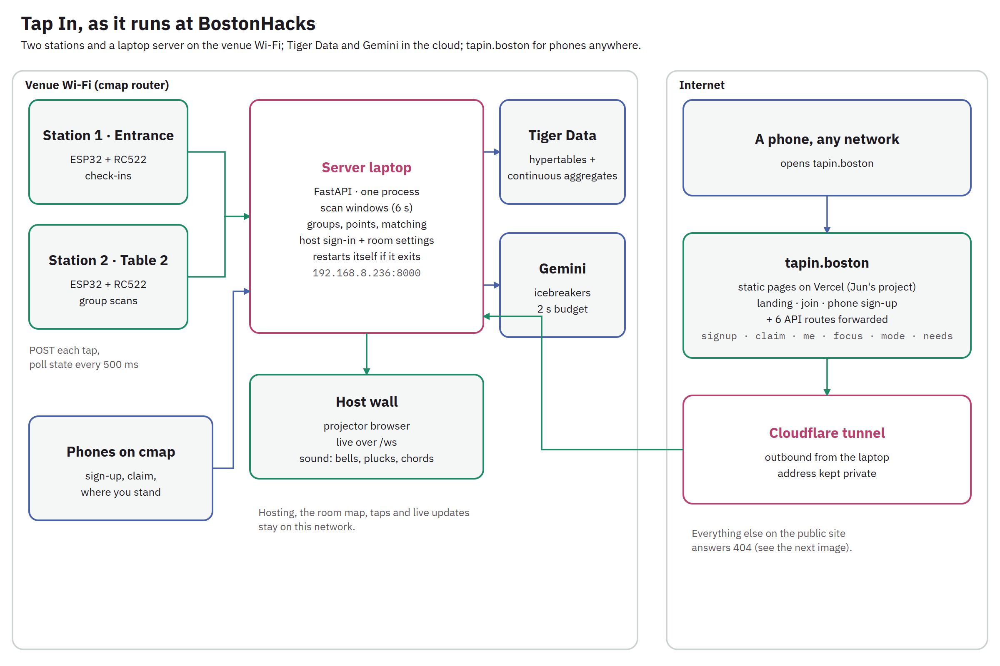

# Tap In: Devpost story (paste into "About the project")

<!-- Owner: Avery. Paste everything below the line into Devpost's "About the project". Layout: standard Devpost headings,
Sponsor Notes with one section per track, prose paragraphs. No attendee counts: we don't have enough real data to quote. -->

---

## Inspiration

Boston is America's college city, and it is easy to be alone in it. You walk into a library, a lab or a hackathon room full of students, and nothing tells you which table to walk up to, so you sit alone next to a group you could have joined. Every shared space we know has the same gap: a room full of people who would help each other, and no way for a newcomer to see where they fit.

Tap In is not another matching app. The phone is only for setup. The matching happens in the room: you join a table by tapping the same station together with someone already sitting there, so the hardware itself makes people meet, and the room can prove they did. Spark!'s own list of ideas includes RFID taps that trigger sounds; we built that, and made every tap a moment the whole room can hear.

## What it does

You make a profile on your phone in about 30 seconds (first name, role, skills, what you're looking for and what you're up to today, which can be "Just hanging out"), then tap any blank badge on a station within 60 seconds and it becomes yours. From then on there is one action: tap your badge.

- **Alone, it checks you in.** The wall rings a bell in your own note, and your phone shows who you already know here, which table needs you and why ("Table B needs firmware, you know 1 of its 3 people"), and your points.
- **Together, it joins a table.** Tap the station with someone already at that table and you join it: everyone in the scan is linked, everyone earns points, and newcomers bring a welcome bonus. A mentor who taps in with a table counts as help and crosses its need off the board.
- **Tables belong to their station.** A table lives where it formed, so the room is physical without tracking anyone: to join a table you walk to it. Two people tapping at a station with no table start a new one there.
- **The room plays it.** The projector shows every table, open needs and how long they've waited, the leaderboard and live activity, and every event has its own sound from one pentatonic scale.
- **Hosts stay in control.** A host sets up the event with a PIN on the venue Wi-Fi, switches the room to quiet mode for study hours, and can unlink a badge or remove a profile from an admin page.

## How we built it

### Stations

Each station is an ESP32 and an RC522 reader in a box, reading badges through the lid. It sends the badge's ID to the server, shows the state the server returns, polls every 500 ms with 800 ms timeouts, and rejoins Wi-Fi by itself. All logic lives on the server, so a station never needs reflashing to change a rule.

### Server

Python FastAPI on one laptop on the venue Wi-Fi. Each station keeps one scan window of 12 seconds that restarts on every tap (time to pass a badge and tap together), and the same badge within 3 seconds counts once. When the window closes, one database transaction decides what the scan means (check-in, new table, join, help or repeat), awards points and pushes the result to every screen over a WebSocket.

### Wall and phone

The wall is plain JavaScript on a canvas with Tone.js for sound. The phone pages are plain HTML and JavaScript with no app and no password: your badge is your identity, and returning visitors log in by tapping it.

### tapin.boston

The pages are static files on Vercel. Nine API routes reach the laptop through a Cloudflare tunnel: sign-up, claim, where you stand, focus, table mode and needs, plus a read-only view of the room that the public map refreshes every 5 seconds. Taps, stations, hosting, badge log-in and the admin page never leave the venue network, so nothing on the public site can change the room.

System architecture.

## Sponsor Notes

### 🔔 Spark! Hack Our Space

#### INTERACTION BETWEEN PEOPLE IS BUILT INTO THE HARDWARE

A join only counts when the newcomer and someone already at the table tap the same station within seconds of each other. You cannot join a table from across the room, and nobody joins a table without someone from it tapping in with them, so consent is built in too. The scan is the proof that two people met.

#### TAPS THAT PLAY

Every tap rings a bell in your own note, every new link plucks both people's notes, a table forming plays a quick rising run, a mentor's help plays a chord, and every 10th arrival rings a trolley bell. The notes all come from one pentatonic scale, so overlapping sounds never clash. Staff switch the room between event mode and quiet mode.

Every event and its sound, all from one pentatonic scale.

#### MADE FOR THE PEOPLE IN THE ROOM

Not everyone wants to be found. A table can switch to heads-down and a person to focus mode, and they stay on the map but are never suggested. The "working on" field has quick picks that aren't projects ("Just hanging out", "Studying", "Meeting new people"), so nobody needs a project to tap in. Profiles are opt-in, first name only, no student IDs, and a host can delete one on request.

#### FOR THE SPACE'S STAFF

The needs board shows what each open table is looking for and how long it has waited, so staff can see who to connect. Mentor taps count as help, not joins. Hosts set the room up with a PIN, and the admin page can unlink a badge so it can be handed to the next person, or give someone a new one, with live status as it lands.

#### A PERMANENT INSTALL AT SPARK!

With the equipment budget: a station at the entrance, the couches and the workbenches, about $15 of parts each and cents per badge, plus a laptop and a screen. Points tied to real perks in the lab, and an hourly view of which station is busiest, already computed in Tiger Data, to show staff how the space connects people. The stations need nothing but Wi-Fi and power, and the rules live on the server, so the install can grow without touching the hardware.

#### EVIDENCE

Measured on our two stations: over 31 real taps the median time from tap to reply was 259 ms. Both stations ran a 40-minute soak with no failed polls, came back on their own within about a second after the server was down for 19 seconds, and rejoined Wi-Fi about 5 seconds after the router came back.

The host wall, filled with sample data from our fake server, so no real attendee is shown.

### 🚇 Boundless Boston

Boston is full of students, and most of them study in shared rooms: libraries, dorm lounges, labs and cafés. Any of those rooms could run Tap In with the same two stations, a laptop and a screen, and nothing about it is specific to a hackathon. It lives at its own Boston address, tapin.boston, where anyone can sign up from their phone on any network.

### 👨🏻‍💻 MLH

- **Tiger Data:** taps are time-series from the first byte, so every raw tap goes into the `taps` hypertable and every resolved scan into `scan_events`. The wall's live chart reads `scans_per_10min`, a real-time continuous aggregate (`materialized_only = false`, so the newest minutes show before they're materialized), and `scans_per_hour` is a hierarchical continuous aggregate on top of it for the busiest-station-by-hour view. `connections` stays a regular table on purpose: a unique index on a hypertable must include the time column, and we need one row per pair of people.
- **Gemini:** when someone checks in, the wall shows their best table at once with a template line, and in the background the server asks `gemini-3.5-flash-lite` for one icebreaker under 20 words from the person's skills and the table's project. If it answers within 2 seconds the wall swaps the line in; if it's late, the template stays, so Gemini can only make the wall better, never slower. We picked the model by timing the candidates with our real prompt. The key never leaves the server.

Two hypertables and two continuous aggregates.

## Challenges we ran into

Taps arrive milliseconds apart, sometimes at two stations at once, so each station keeps one window whose timer restarts on every tap, and the window is removed before it resolves so a late tap starts a fresh scan instead of corrupting the old one. The group rules took real testing to get right: our first rule needed every member of a table to tap in with a newcomer, which blocked people in practice, so we changed it to one member and pinned each table to its station. Getting a phone on any network to reach a laptop on a private router took a tunnel, and the tunnel's default protocol kept dropping on the venue network until we switched it to HTTP/2. Badge claims failed at first because 30 seconds wasn't long enough to reach a station, so we doubled it.

## Accomplishments that we're proud of

Both stations passed soak tests, a server outage and a router unplug, and recovered on their own every time. A phone on any network can sign up at tapin.boston while taps and hosting stay on the venue network. And four people merged more than 115 pull requests in about 24 hours without breaking main, each working with a coding agent, all coordinating on one pinned GitHub issue.

## What we learned

Writing every JSON shape down before coding let the stations, server, wall and phone meet on the first try. Measuring beat assuming every time: the Gemini model in our plan didn't exist for our key, and timing the alternatives with our real prompt picked the one we use. Watching real people tap taught us more than any test: rules that looked right on paper, like needing a whole table to tap in, got in the way of two people who just wanted to sit together.

## What didn't work

We had only 10 badges, so few real people could join, and we don't have enough real use to quote numbers yet. We planned five LEDs per station and cut them for time, so the wall and its sound carry the feedback.

## What's next for Tap In

A permanent install at Spark! with stations at the entrance, the couches and the workbenches, and points tied to real perks in the lab. Signed NTAG424 badges instead of IDs that can be cloned. Then more rooms in Boston, libraries and dorm lounges, where the same stations would work unchanged.
