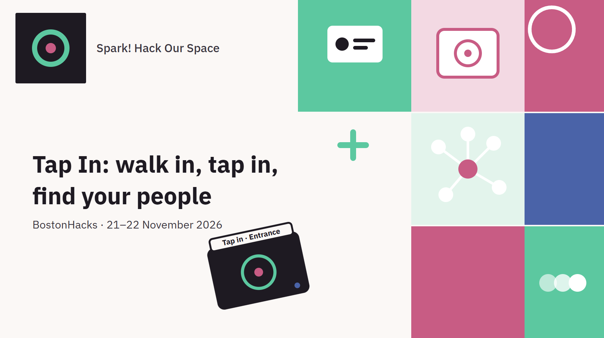
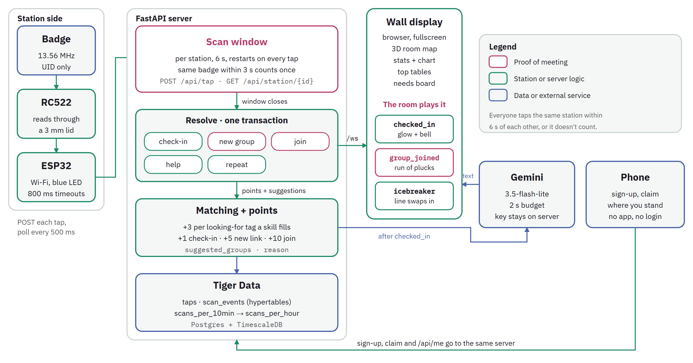
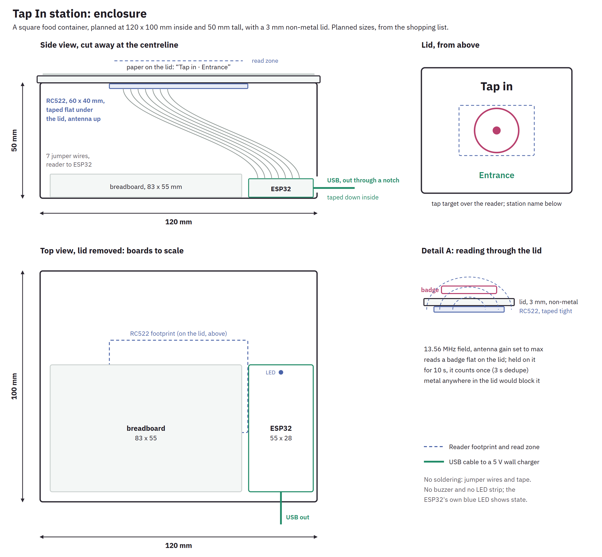
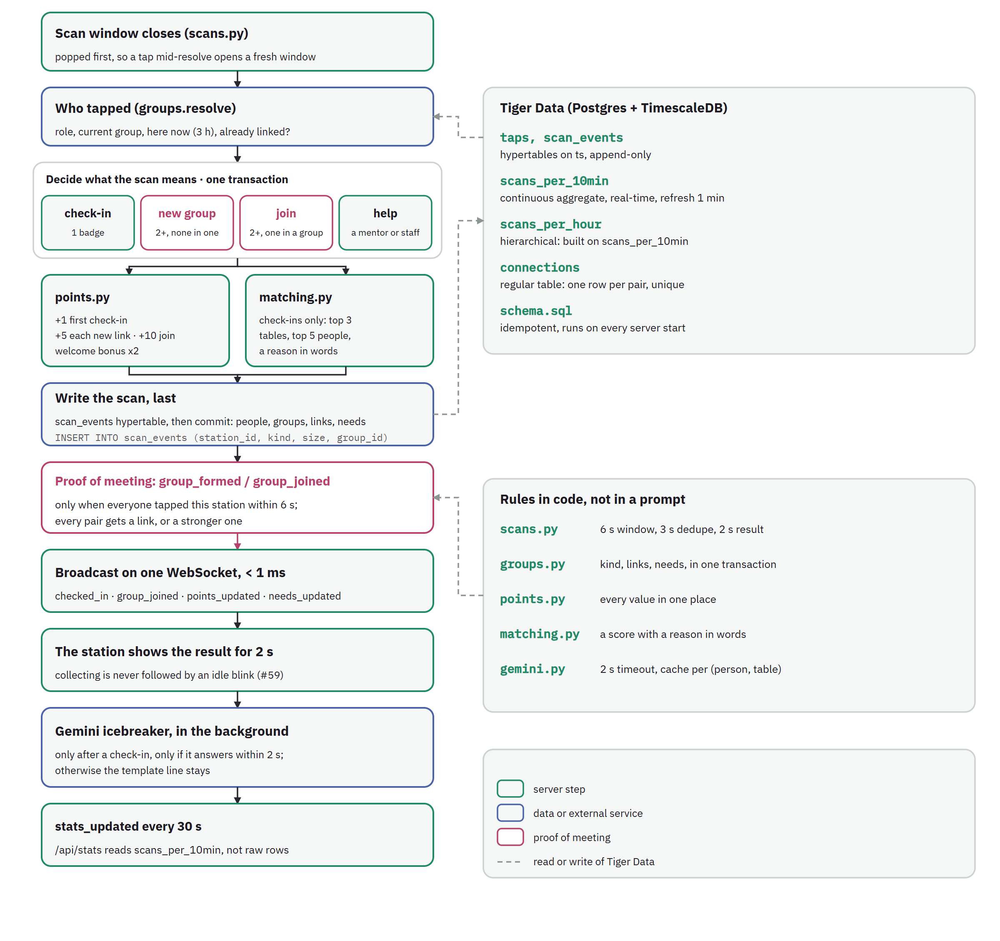
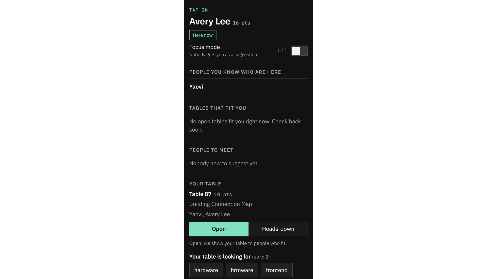
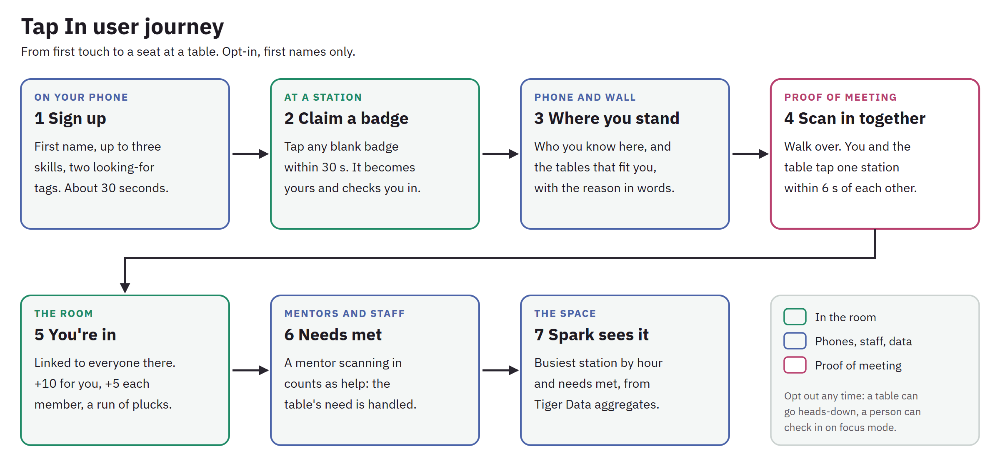
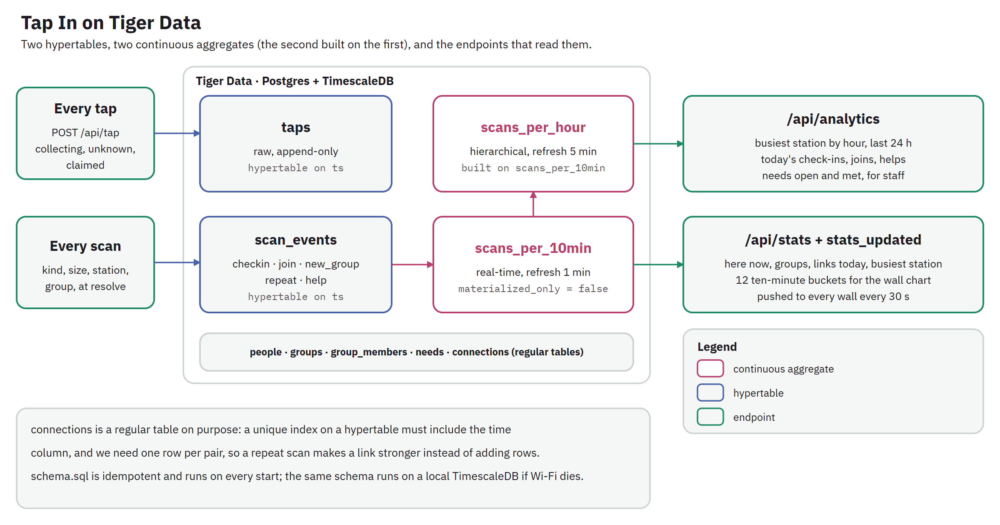
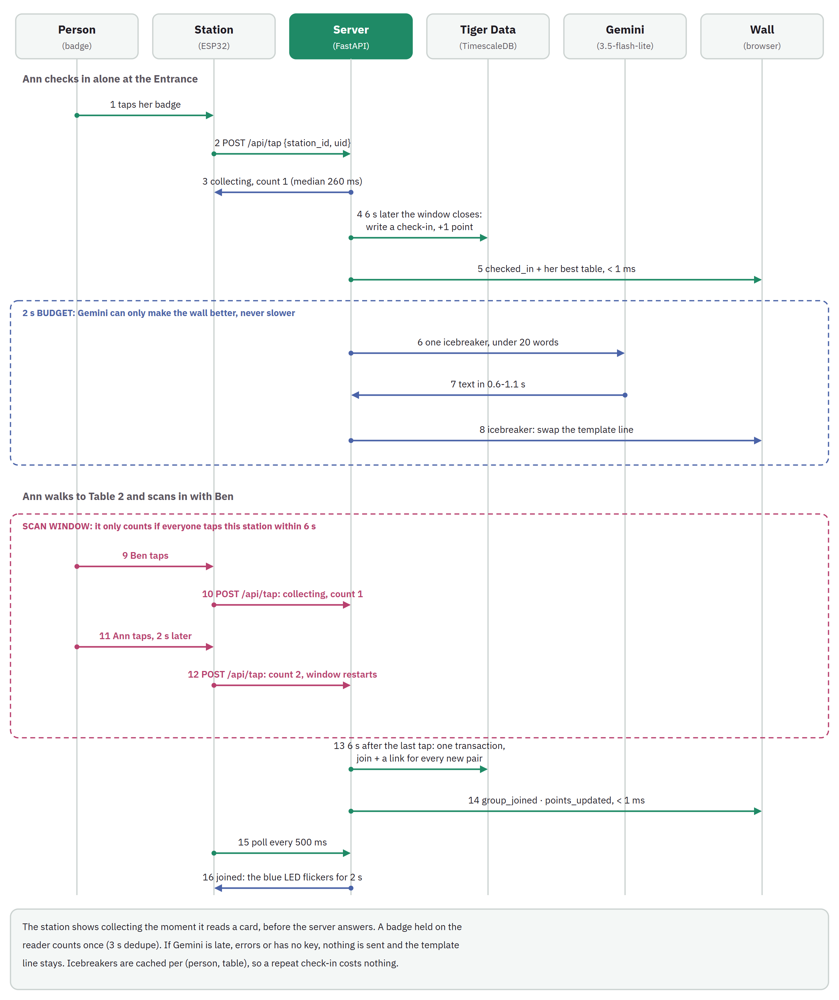

# Tap In — Devpost story (paste into the Devpost "Story" box)

<!--
Owner: Avery (Devpost). Written in the structure of HackPrinceton '26's Lucid page: a personal hook, a tight
"What it does", "How we built it" by component, then Sponsor Notes with one block per prize, each organized
around that prize's own judging words. Rule from Yaovi: nothing goes in as working unless someone on the team
saw it work; every [CHECK] must be filled with a real number or quote, or cut, before submitting.
Images live in media/devpost/ and are embedded from the repo's main branch.
-->

**Tagline:** Walk into a room, tap in, find your people.

## Inspiration

Boston is America's college city, and it is easy to be alone in it. [CHECK: David's story, in his words: moving to Boston, walking into a study space or a lab full of people, sitting alone next to a table he could have joined.] Every shared space we know has the same gap: a room full of people who would help each other, and nothing that tells a newcomer which table to walk up to. App-only matching has been tried here before (Spark! Connects at BostonHacks 2023) and didn't place, because the phone is the thing that keeps you at your own table. We wanted the room itself to do the matching.

## What it does

You make a profile on your phone in about 30 seconds: a first name, up to three skills, up to two things you're looking for, and what you're working on. Then you tap any blank badge on a station to make it yours, and that tap also checks you in. You light up on the wall, and the wall and your phone show where you stand: the people you already know who are here, and the tables that could use you, in plain words, like "Table 2 is building a robot arm and needs firmware. You know 1 of its 3 people." Walk over, and you and the table scan in together on their station. You're added to the group, linked to everyone in it, and everyone earns points. Joining only counts when the whole group taps the same station within seconds of each other, so the hardware proves the meeting happened. Mentors scanning in with a table count as help: the table's need is marked handled and the mentor shows up as a bridge between groups.

## How we built it

System architecture: two ESP32 stations, one FastAPI server, Tiger Data, Gemini, the wall and the phone.

### Stations

Each station is an ESP32 and an RC522 reader on a breadboard, in a box with the reader taped under the lid. The station is deliberately dumb: it sends the badge's UID to the server and shows whatever state the server returns, polling every 500 ms. It shows "collecting" the moment a card is read, before the server answers, so a tap feels instant. Every request times out after 800 ms, Wi-Fi rejoins by itself, and nothing in the main loop ever waits, so a slow network can't freeze a reader. The board's blue LED shows each of the nine states as its own rhythm.

The station enclosure: side view, the lid, the boards to scale, and reading through the lid (planned sizes).

### Server

Python FastAPI on one laptop. The hard part is the scan window: taps that land on the same station within 6 seconds of each other are one scan, every new tap restarts the 6 seconds, and two stations never share a window. When the window closes, one database transaction decides what the scan means (check-in, new group, join, help, or repeat), writes it, and the server pushes the result to every screen over one WebSocket.

One scan, from the window closing to the wall, with the rules kept in code and the reads and writes to Tiger Data.

### Wall and phone

The wall is a 3D room map, not a network graph: each group is a cluster at its table, people who just checked in glow, lines reach the people they know, and the tables that fit them pulse. A right column shows live stats, a scans-per-10-minutes chart, top tables, the needs board and recent activity, and Tone.js plays a bell for a new person and a run of plucks for a group forming. The phone site handles sign-up, the badge claim, and "where you stand"; mentors and staff get the needs board with wait times.

The phone's "where you stand" page, live from our server: who you know here, the tables that fit you, and your table's open or heads-down switch.

The user journey, from first touch to a seat at a table.

### How four people (and their coding agents) built it in parallel

We agreed on the JSON shapes first, so the four layers could be built without waiting on each other. Every teammate's coding agent read and posted on one pinned GitHub issue, so one person's agent could hand work to another's, ask the owner before touching their files, and flag a contract change to everyone at once.

## Sponsor Notes

### 🐯 MLH: Best Use of Tiger Data

Tap In is a stream of taps, so its data is time-series from the first byte, and Tiger Data holds all of it.

Two hypertables feed two continuous aggregates, the second built on the first.

**Hypertables.** Every raw tap goes into `taps` (station, badge, result) and every resolved scan into `scan_events` (kind, size, station, group), both hypertables partitioned on time.

**Continuous aggregates.** `scans_per_10min` counts scans per station and kind in 10-minute buckets, in real-time mode (`materialized_only = false`), so the wall's chart includes the newest minutes before the 1-minute refresh policy materializes them. `scans_per_hour` is a hierarchical continuous aggregate built on top of `scans_per_10min`, refreshed every 5 minutes; it powers the busiest-station-by-hour view for the space's staff.

**What it powers.** `GET /api/stats` (people here now, active groups, links today, busiest station, and 12 zero-filled ten-minute buckets) is pushed to every wall every 30 seconds as `stats_updated`. `GET /api/analytics` returns the last 24 hours by station, today's mix of check-ins, joins, repeats and helps, and how many needs are open and met.

**Design decisions.**
- `connections` is deliberately a regular table: a unique index on a hypertable must include the time column, and we need exactly one row per pair of people, so a repeat scan makes a link stronger instead of adding rows.
- `schema.sql` runs on every server start and is idempotent (`IF NOT EXISTS` on the views, `if_not_exists` on the policies), so a restart in the middle of the event never breaks the database.
- "Links today" resets at midnight Boston time, not UTC (which would reset at 7 PM, mid-recruiting).
- The same schema runs on a local TimescaleDB container if the venue Wi-Fi dies; only `DATABASE_URL` changes.

**Verified.** On a local TimescaleDB with the same schema, the current hour shows up live through the hierarchical aggregate before any refresh, and both aggregates and their policies exist exactly once after repeated restarts. On the live Tiger Data service, both aggregates are created at server start and `/api/stats` and `/api/analytics` answer from them. [CHECK: a screenshot of the live chart at judging.]

### ✨ MLH: Best Use of Gemini API

Gemini writes each person's icebreaker for the table that fits them best, without ever making a tap wait.

Two taps, end to end: a check-in with its Gemini icebreaker inside a 2-second budget, then a join inside the 6-second scan window.

**Where it runs.** When someone checks in, the wall shows their top suggested table right away with a template line ("{name} ({skill}): {table} needs {need}"). In the background, the server asks Gemini for one icebreaker under 20 words, from the person's name and skills and the table's project and needs, with no emojis and no exclamation marks.

**The 2-second budget.** If Gemini answers within 2 seconds, the server sends an `icebreaker` event and the wall swaps the line. If it is late, errors, or there's no key, nothing is sent and the template line simply stays, so Gemini can only ever make the wall better, never slower.

**Choosing the model by measuring it.** Our plan named gemini-2.5-flash, which returns 404 for new API keys. We timed the available models with the real prompt, three calls each: gemini-3.5-flash-lite answered in 0.6 to 1.1 s; gemini-3.8-flash was overloaded (503) and gemini-3.7-flash timed out. We picked the pinned 3.5-flash-lite over the faster-looking `-latest` alias, which could change under us mid-event.

**Details.**
- Answers are cached per (person, table), so a repeat check-in costs nothing.
- The output is cleaned: first line only, no emoji, any "!" softened.
- The API key stays in `.env` on the server and is sent only to Google, as a header. It never reaches a browser.

**A real one from tonight**, 0.9 s after a check-in: "Avery, your firmware and pitch skills fit Connection Map's design needs well." [CHECK: swap in a judge's or a recruit's if a better one comes up.]

### 🏛️ Spark! Hack Our Space

**Interaction between people, built into the hardware.** A join only counts when everyone is at the same station within seconds of each other. The room does the matching, and the scan is the proof that people met.

**For the space's staff.** The needs board shows what each open table is looking for and how long it has waited, mentors scanning in count as help, and the busiest-station-by-hour view shows how the space connects people over a day.

**Real users.** [CHECK: N people signed up and claimed a badge, G groups formed, H mentor helps, from tools/count.py, which counts real people only and excludes our test and judge badges. Two or three quotes from people who tried it.]

**A permanent install.** [CHECK: the plan for Spark: a station at the entrance, the couches and the workbenches, points tied to a real perk in the lab.]

### 🗺️ Boundless Boston

[CHECK: one paragraph: any library, dorm lounge or lab in Boston could run this; about $15 of parts per station and cents per badge; the city-scale slide from the pitch.]

### 🌐 GoDaddy Registry: Best Domain

[CHECK: tapin.boston, and whether it serves the phone site at judging.]

## Challenges we ran into

Taps arrive milliseconds apart, sometimes at two stations at once, so grouping them into scans without corrupting one another was the hardest part of the server. On the hardware side:
- **The stations joined no network at first.** We made the firmware log why a Wi-Fi join fails. It said "network not found" (the router broadcast a different name than our plan), then "auth failed" (we had the router's admin password, not its Wi-Fi password).
- **A blink of "nothing happened".** Between "collecting" and the result, the server briefly reported "idle" while it wrote the scan, so stations flashed idle right before "you're in". The server now keeps reporting "collecting" until the result is set, with a test that fails on the old code.
- **Gemini returned 404 for every icebreaker** until we measured the available models and switched (above).

## Accomplishments that we're proud of

- Both stations passed 30- and 40-minute soak tests with no reboots and no time offline, and recovered on their own within 1 second when we took the server down.
- The scan-window stress tests all pass against the live database: two stations in the same second, a window extended at 5.9 s and 11 s, a badge held on the reader for 10 s counted once.
- [CHECK]

## What didn't work

We planned five LEDs per station and cut them for time, so a station's only feedback is a small blue LED, and a group joining no longer lights up the box. Each station request takes about 200 ms even though the network answers in 3 ms; we ruled out the Wi-Fi signal, connection reuse and the server, and ran out of time to chase it into the ESP32's network stack. [CHECK]

## What we learned

[CHECK]

## What's next for Tap In

[CHECK: Spark's lab install, perks for points, more spaces in Boston, signed NTAG424 badges instead of clonable UIDs.]

## Gallery (captions)

1. `cover.png`: Tap In: walk in, tap in, find your people.
2. `wall.png`: The live wall: the room map, stats, top tables and the needs board. [CHECK: retake after recruiting, mid check-in, with a full room.]
3. `phone-signup.png`: Sign-up on the phone: a first name, three skills, two looking-for tags.
4. `phone-where-you-stand.png`: Where you stand: who you know here and the tables that fit you.
5. [CHECK: photo] Both stations, boxed, at the Entrance and Table 2.
6. [CHECK: photo] A badge tap close-up, with the blue LED going solid.
7. `architecture.png`: System architecture.
8. `scan-pipeline.png`: One scan, end to end.
9. `tap-sequence.png`: A check-in with its Gemini icebreaker, then a join.
10. `enclosure.png`: The station enclosure (planned sizes).

Label any clip from the demo wall or Jun's prototype as "demo" or "prototype", never as real data.

## Built with

arduino · esp32 · rc522 · c++ · python · fastapi · uvicorn · asyncpg · websockets · postgresql · timescaledb · tiger-data · gemini · javascript · tone.js · html5 · css3
